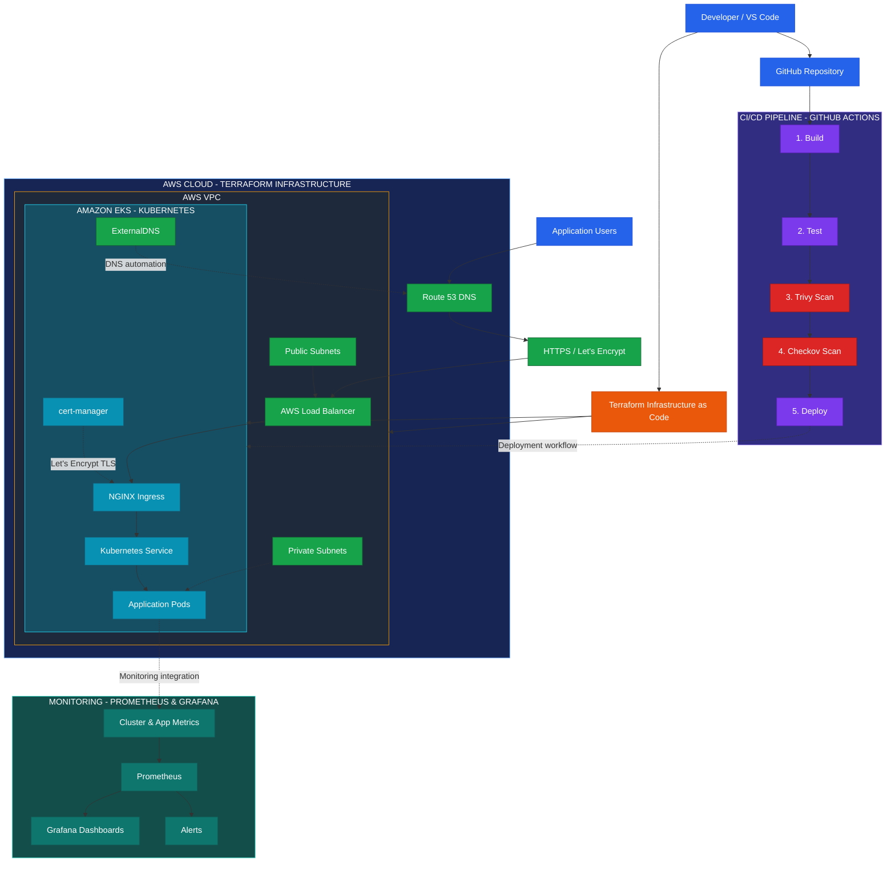

# AWS EKS DevOps Architecture

## Infrastructure | CI/CD | Security | Monitoring

## Architecture Overview

### 1. CI/CD Pipeline
GitHub Actions is used for CI automation and security scanning. The architecture shows the target workflow: Build, Test, Trivy, Checkov and Deploy.

### 2. AWS Infrastructure
Terraform defines the AWS VPC, public and private subnets, networking resources and Amazon EKS infrastructure.

### 3. Kubernetes
Amazon EKS hosts the Kubernetes environment, including NGINX Ingress, Kubernetes Services and application pods.

### 4. DNS and HTTPS
Route 53 and ExternalDNS support DNS management. cert-manager integrates with Let's Encrypt for TLS certificate management.

### 5. Security
Trivy performs vulnerability scanning, while Checkov checks Terraform infrastructure configuration for security issues.

### 6. Monitoring Architecture
The diagram illustrates a Prometheus and Grafana monitoring design for application and cluster metrics, dashboards and alerting.